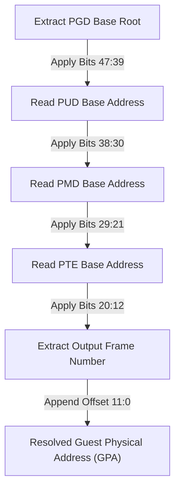

# Ch.3.2 - Manual Page Table Walking

## 1.1 Emulating the Hardware MMU Loop
To resolve an ARM64 application pointer completely out-of-process from the host, the SDK must traverse the 4-level table hierarchy sequentially inside the raw byte stream pool.



## 1.2 Descriptor Scaling Calculations
Because every entry within an execution table consumes exactly **8 bytes** in a 64-bit architecture, the relative offset point is shifted left by 3 bits (`<< 3`):

\[\text{Entry Memory Address} = \text{Table Base Address} + (\text{Index} \times 8)\]

## 1.3 C# Page Table Walking Engine Blueprint
The framework emulates this multi-tiered look-up engine using explicit conditional block transitions:

!!! abstract "C# Out-of-Process 4-Level Page Table Walker"
    ```csharp
    public static class HardwareMmuEmulator
    {
        public static ulong TranslateVirtualToPhysical(ulong gva, ulong pgdBaseGpa, IntPtr upperBaseHva)
        {
            // 1. Break down incoming GVA target into component layout indices
            var coordinates = AddressDisassembler.SplitVirtualAddress(gva);

            // 2. Traversal Loop Tier 1: PGD -> PUD
            IntPtr pgdEntryHva = HypervisorRouter.TranslateGpaToHva(pgdBaseGpa + (coordinates.PgdIndex * 8), IntPtr.Zero, upperBaseHva);
            ulong pudBaseGpa = MemoryReader.ReadUInt64(pgdEntryHva) & 0x0000FFFFFFFFF000UL; // Extract output physical framing address masks

            // 3. Traversal Loop Tier 2: PUD -> PMD
            IntPtr pudEntryHva = HypervisorRouter.TranslateGpaToHva(pudBaseGpa + (coordinates.PudIndex * 8), IntPtr.Zero, upperBaseHva);
            ulong pmdBaseGpa = MemoryReader.ReadUInt64(pudEntryHva) & 0x0000FFFFFFFFF000UL;

            // 4. Traversal Loop Tier 3: PMD -> PTE
            IntPtr pmdEntryHva = HypervisorRouter.TranslateGpaToHva(pmdBaseGpa + (coordinates.PmdIndex * 8), IntPtr.Zero, upperBaseHva);
            ulong pteBaseGpa = MemoryReader.ReadUInt64(pmdEntryHva) & 0x0000FFFFFFFFF000UL;

            // 5. Traversal Loop Tier 4: PTE -> Physical Page Frame Base
            IntPtr pteEntryHva = HypervisorRouter.TranslateGpaToHva(pteBaseGpa + (coordinates.PteIndex * 8), IntPtr.Zero, upperBaseHva);
            ulong physicalFrameBaseGpa = MemoryReader.ReadUInt64(pteEntryHva) & 0x0000FFFFFFFFF000UL;

            // 6. Append lower page relative offset to isolate absolute GPA coordinate
            return physicalFrameBaseGpa + coordinates.PageOffset;
        }
    }
    ```
