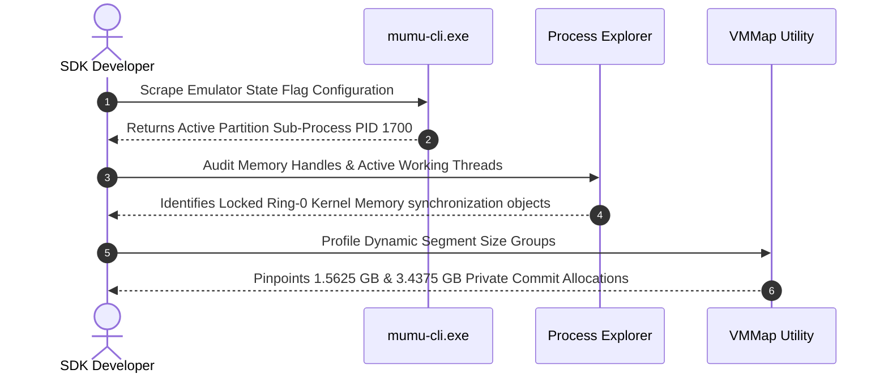

# Ch.4.1 - Research Methods & Diagnostic Provenance

## 1.1 Empirical Verification Log Overview
This chapter structures the real-world reverse engineering logs gathered via external diagnostic software to validate our memory model assumptions, transforming assumptions into hard mathematical parameters.

### Investigation Protocol Pipeline


## 1.2 Live Diagnostics Capture Reference Records

!!! note "Instance Descriptor Capture Frame"
    ```json
    {
      "0": {
        "adb_port": 16384,
        "hyperv_enabled": true,
        "pid": 1700,
        "player_state": "start_finished"
      }
    }
    ```

### Verified Footprint Metric Parameters
*   **WHP Execution Constraints:** The indicator `"hyperv_enabled": true` proves the guest partition is managed by the Windows Hypervisor Platform kernel tables.
*   **The Private Data Sizing Split:** Dynamic sweeps across the working set maps reveal exactly two allocations exceeding 1 GB, categorized as `Private Data` with `PAGE_READWRITE` permissions. The total combined payload maps to exactly 5 GB of hardware RAM space.
