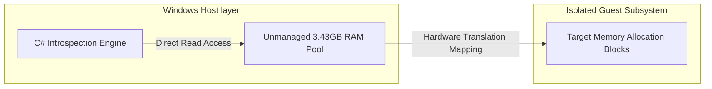

# Ch.6.1 - Run-time Metadata Inspection

## 1.1 The Invariant Auditing Solution
This chapter outlines the standard architectural patterns for Virtual Machine Introspection (VMI). The application operates exclusively from the Windows Host layer to inspect active runtime states in an un-opinionated fashion.

## 1.2 Bypassing Guest Protection Systems Natively
By implementing our memory diagnostics framework at this level, we decouple our utility entirely from the application layer execution loops.

*   **Virtual Memory Area Audits:** Rather than relying on guest software queries, the engine parses the kernel's process memory descriptors directly to trace application memory allocations.
*   **Complete Isolation:** Because our reading mechanism interacts exclusively with unmanaged memory pages owned by the host hypervisor process, it remains completely invisible to guest security frameworks. The target environment cannot intercept or scan your utility because the code runs entirely outside its virtualization context.
