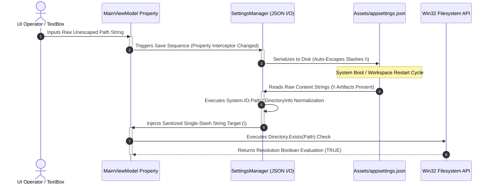

\# Application Configuration \& Settings Persistence

This document defines the structural parameters and file storage patterns used to persist environment configurations across execution lifecycles.

\---

\## 🧭 Principles \& Security Boundaries

To maintain absolute architectural decoupled isolation:

\*   \*\*Static Asset Strategy:\*\* Settings are maintained via standard human-readable JSON payloads stored within local application working partitions.

\*   \*\*Zero Hardcoding Enforcements:\*\* Physical installations tracks, baseline window states, and process tag identifiers must never be compiled as permanent constants into assembly files.

\*   \*\*Graceful Structural Fallbacks:\*\* If a configuration file is missing or corrupt, the initialization pipelines must automatically intercept the failure, spin up safe default values, and build a pristine template out-of-the-box.

\## 🛑 Safe Path Management Mandate

Manual string interpolation, substrings, or character replaces (`.Replace()`) are strictly prohibited for file layout tracking. All filesystem boundaries must rely natively on the `System.IO.Path` library.

\*   \*\*Normalization Rule:\*\* Any string extracted from raw JSON inputs or dynamic user interface input forms must pass through `System.IO.Path.GetFullPath()` to strip double-escaped artifacts, handle cross-platform slashes, and anchor absolute roots.

\*   \*\*Combination Rule:\*\* Joining folders or appending configuration names must pass exclusively through `System.IO.Path.Combine()`. Manual string concatenation (`+` or `$""`) is banned.

## 🔄 The Path Serialization Lifecycle

