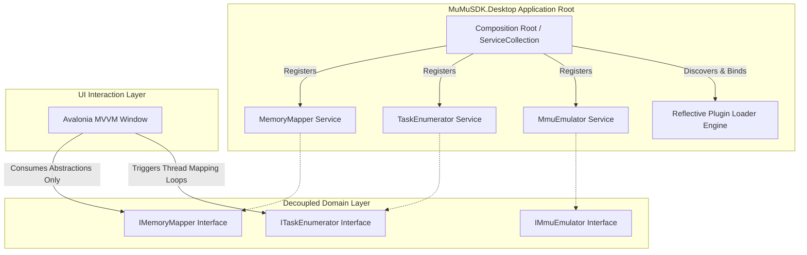

# System Dependencies & Dependency Injection Architecture

This document maps out the system dependencies, service compilation matrix, and cross-platform UI integration layers for the workspace.

---

## 🏗️ The Composition Root & Architecture Heart

To scale the engine cleanly without introducing structural drift, the solution leverages **Inversion of Control (IoC)** via standard dependency injection abstractions. The desktop interface acts as the initialization hull, while the core library serves as the execution engine.



---

## ⚙️ Core Solution Dependencies

### 1. Framework Runtimes
*   **Core SDK Assemblies:** Target **`.NET 10`** (Class Library Runtimes) to optimize memory pinning operations, unmanaged allocation casting (`unsafe`), and hardware execution contexts via cutting-edge JIT optimizations.
*   **UI Application Base:** Target **`.NET 10`** via the **Avalonia UI** cross-platform ecosystem.

### 2. NuGet Package Dependencies Matrix

| Package Name | Targeted Assembly Space | Structural Architecture Purpose |
| :--- | :--- | :--- |
| `Microsoft.Extensions.DependencyInjection` | `MuMuSDK.Desktop` | Establishes the centralized Composition Root container loop under .NET 10. |
| `Avalonia` | `MuMuSDK.Desktop` | Delivers a cross-platform, high-performance XAML engine built outside Win32 dependencies. |
| `Avalonia.Themes.Fluent` | `MuMuSDK.Desktop` | Standard styling baseline mapping cleanly to dark-mode host layouts. |
| `Avalonia.ReactiveUI` | `MuMuSDK.Desktop` | Implements an asynchronous MVVM layout architecture to isolate view-states from backend memory loops. |

---

## 🧱 Dependency Injection Integration Constraints

=== "Service Registration Workflow"
    All foundational hardware translation utilities must register with transient or singleton lifecycles inside the presentation bootstrapper before dynamic assemblies are scanned:
    
    ```csharp
    // Conceptual View of the Solution Architecture Heart (.NET 10 Dependency Resolution)
    var serviceProvider = new ServiceCollection()
        .AddSingleton<IMemoryMapper, MemoryMapper>()
        .AddSingleton<ITaskEnumerator, TaskEnumerator>()
        .AddSingleton<IMmuEmulator, MmuEmulator>()
        .BuildServiceProvider();
    ```

=== "Avalonia MVVM Isolation Rules"
    !!! success "UI Layer Separation Rule"
        To ensure total infrastructure safety, the Avalonia presentation layer must never capture direct pointer references or memory layout streams. 
        
        The ViewModels interact exclusively with interface contracts exposed by the Core SDK. The live UI loops thread-safe, text-mapped diagnostic metrics into the display grid using standard data binding patterns, leaving the heavy bit-shifting tasks completely isolated on dedicated background processing threads.
