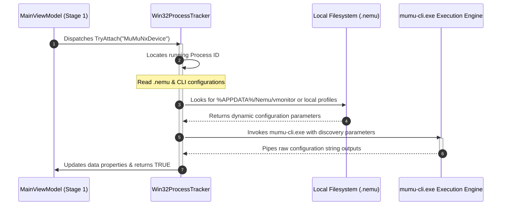

# Emulator Environment Extraction & CLI Integration

This document defines the automated discovery mechanics used to analyze hypervisor `.nemu` state configurations and query configuration data strings using the native `mumu-cli.exe` engine.

---

## 🧭 Principles & Decoupled Execution Guards

To keep unmanaged side effects away from your core UI thread presentation:
*   **Asynchronous Processing:** Calling secondary executable utilities or scraping disk configuration clusters must occur entirely within separate worker tasks to prevent UI thread stuttering.
*   **Path Composition Guarantees:** File tracking coordinates must derive dynamically from the user's validated home installation directory path, explicitly leaning on `System.IO.Path` combinations.
*   **Defensive Parsing Fallbacks:** If a `.nemu` asset configuration profile is corrupt, missing, or blocked by local Windows ACL restrictions, the scanner must fall back gracefully to standard address ranges without crashing the master workspace pipeline.

---

## 📊 Environment Discovery Timeline

## 🛑 NetEase Terminology Mapping Context

To maintain absolute alignment with the underlying native hypervisor orchestration binaries, developer teams must adapt to the following syntax nomenclature:
*   **Virtual Machine Instance Mapping:** Formally declared as a **"Player"** across all native subcommands.
*   **Target Instance Filtering:** Checked utilizing the explicit `-v` or `--vmindex` selector arguments, where index `0` represents the primary global system container.
