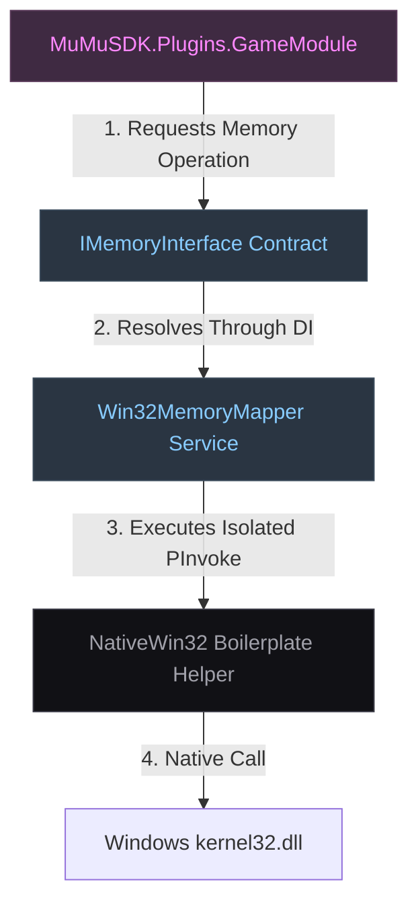

# Strict Kernel Encapsulation Boundary Matrix

This document defines the strict horizontal decoupling guarantees that isolate external game plugin modules from host platform kernel infrastructure.

---

## 🧭 Invariant Boundary Constraints

To defend the system architecture from platform drift, runtime crashes, and compilation vulnerabilities:
*   **The Downstream Isolation Mandate:** Game plugins and presentation elements are strictly barred from importing `System.Runtime.InteropServices` or interacting with bare-metal elements.
*   **The Inversion Proxy Rule:** Any low-level action required by a module (e.g., reading target virtual addresses, checking hardware signatures) must be exposed via abstract interfaces inside `MuMuSDK.Core`. 
*   **Zero Raw Handle Exposure:** External assemblies must never hold or request raw memory pointer references (`IntPtr`). They communicate exclusively using managed arrays, primitive integers, and safe hex data strings.

---

## 📊 Structural Interop Proxy Flow

