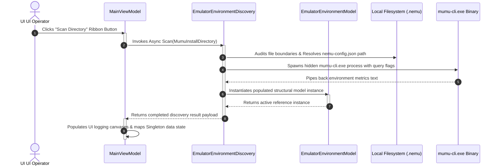
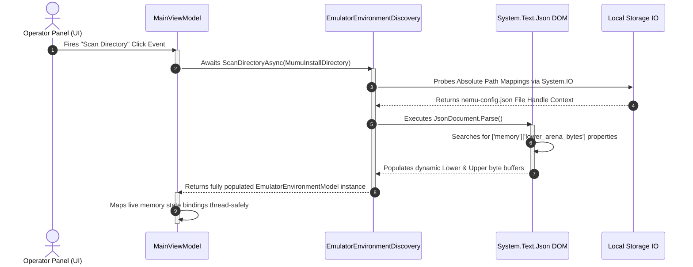

# Pre-Attachment Environment Discovery Subsystem

This document outlines the operational boundaries, data models, and asynchronous discovery tracks used to audit an active emulator directory installation prior to process hook attachments.

---

## 🧭 Principles & Lifecycle States

*   **Isolation Guarantee:** Environment scanning is purely a disk-bound and local binary query operation. It is decoupled from raw memory introspection logic and requires zero process handle permissions.
*   **Immutable Resolution:** Once a data model is successfully generated by the parser, its fields remain static and available to downstream driver components via Dependency Injection.

---

## 📊 Discovery Sequence Timeline

## 📊 Pre-Attachment Scanning Data Pipeline

