\# Process Attachment \& Native Handle Subsystem

This document specifies the interface abstraction, lifetime containment, and safety guardrails governing native Win32 process context acquisitions.

\---

\## 🧭 Security Boundaries \& Safe Handle Guarantees

To ensure low-overhead execution stability and defend against unmanaged memory resource leaks:

\*   \*\*Encapsulation Clause:\*\* The graphical layout presentation layers are barred from interacting with P/Invoke signatures. All handle isolation is managed by the background core library behind explicit contracts.

\*   \*\*SafeHandle Pattern Enforcement:\*\* Raw `IntPtr` handle tracking is strictly prohibited. Native process tokens must be wrapped using Microsoft's native `SafeProcessHandle` wrapper block to guarantee instant resource reclamation if a background thread crashes.

\*   \*\*Access Control Principle:\*\* Process execution rights must request only the absolute minimum required permissions needed to query virtual pages (`PROCESS\_QUERY\_INFORMATION | PROCESS\_VM\_READ`). Full administrative master tokens (`PROCESS\_ALL\_ACCESS`) are banned.

\---

\## 📊 Process Lifetime State Machine

```mermaid

stateDiagram-v2

&#x20;   \[\*] --> Idle : Application Startup

&#x20;   Idle --> Attacking : Staging Stage 1 Triggered

&#x20;   

&#x20;   state Attacking {

&#x20;       \[\*] --> FindProcessName

&#x20;       FindProcessName --> OpenHandle : Process ID Discovered

&#x20;       OpenHandle --> VerifyRights : SafeProcessHandle Instantiated

&#x20;   }

&#x20;   

&#x20;   Attacking --> Attached : Handle Verified Valid

&#x20;   Attacking --> Failed : Target Process Not Active

&#x20;   

&#x20;   Attached --> ActiveTracking : Ticker Loop Spinning

&#x20;   ActiveTracking --> Idle : Target Process Terminates (Handle Disposed)

&#x20;   Failed --> Idle : Graceful Fallback Reset

```

## ⚙️ Execution Validation Matrix (Pre-Attachment)

To prevent runtime memory faults, thread stalls, or security access exceptions inside host memory spaces, the environment parser must validate the initialization flags of the player target instance prior to binding unmanaged handles:

1.  **Process Engine Verification:** The variable `is_process_started` must evaluate strictly to `true`. This guarantees that the host operating system has successfully spawned the background hypervisor containment layers.
2.  **Guest OS Verification:** The variable `is_android_started` must evaluate strictly to `true`. This ensures the guest kernel layout has completed initialization inside physical RAM cells, making structural signatures accessible to `ReadBytes()`.
3.  **State Status Telemetry:** The field `player_state` must register as `"start_finished"` before the Stage 2 page sweeping sequence is unlocked for execution.
