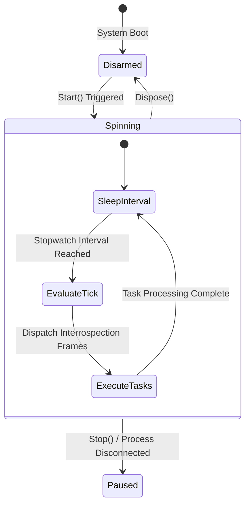

# High-Precision Background Ticker Engine

This document defines the threading topology, stopwatch delta constraints, and loop cycle synchronization pipelines powering the master clock.

---

## 🧭 Synchronization Boundaries & Cadence Guards

To maintain stable background data flow under high refresh rates (10Hz to 20Hz):
*   **Thread Isolation:** The execution clock must never run on or block the Avalonia graphical thread. Loop cycles operate inside a long-running decoupled background task.
*   **Dynamic Cadence Shifting:** The loop must dynamically react to millisecond frequency parameter shifts arriving from the Staging Ribbon (`50ms` - `100ms`) without requiring a complete engine restart.
*   **Delta-Time Safety Guards:** Tasks executed on a clock cycle must track their exact processing duration. If an introspection loop execution time exceeds the target refresh cadence, the system will seamlessly skip the immediate next tick interval to prevent cascading queue overflows.

---

## 📊 Ticker Lifetime State Machine

