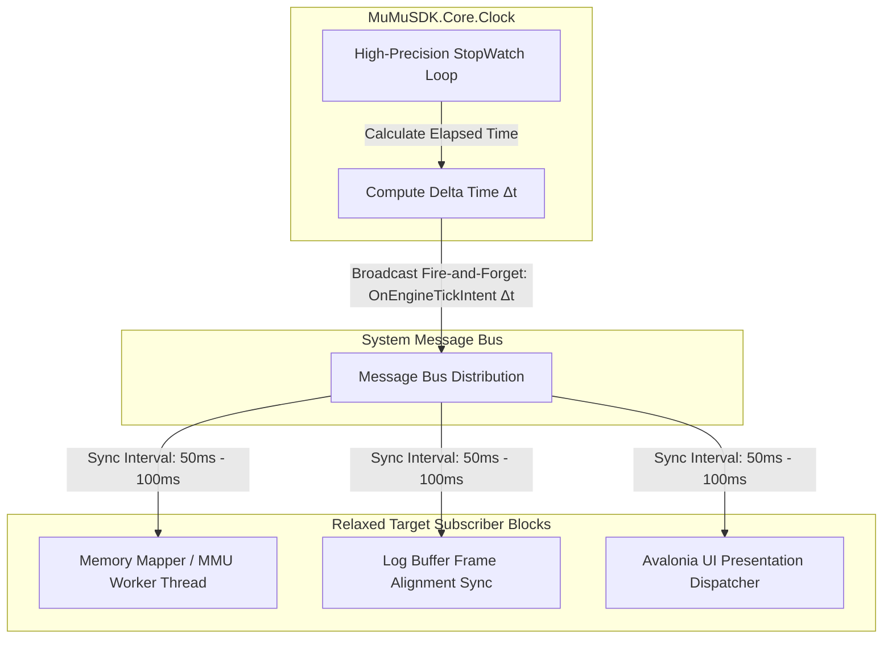

# Master Ticker Engine & Game Loop Synchronization

This document establishes the specifications for the central, delta-time driven tick engine designed to synchronize logging, background memory tasks, and display rendering cycles.

---

## 🧭 The Low-Overhead Game-Loop Philosophy

To avoid asynchronous processing drift without choking host processor cycles, the entire SDK application maps its execution timeline to a unified, low-overhead **Master Ticker Engine**. Modeled after a game engine's core architecture, this service runs a continuous clock pass, computes the exact **Delta Time (Δ t)** since the last tick, and dispatches a synchronized execution intent down the central message bus.



---

## 🧱 The Delta-Time Synchronization Frame Contract

Every processing cycle is bound tightly to an immutable tick message structure passed downhill to listening modules:

```csharp
public readonly record struct EngineTickFrame(
    ulong FrameIndex,       // Monotonically increasing index tracking total loop passes
    double DeltaTime,       // Time elapsed since last tick (expressed in fractional seconds)
    double TotalRuntime     // Total elapsed execution runtime since engine boot
);
```

---

## ⚙️ Subsystem Synchronization Requirements

When an `EngineTickFrame` intent drops down the system message bus, subscribing tasks must execute their step-by-step logic sequentially based on the relaxed interval rate:

### 1. Introspection Workers (`MemoryMapper` / `MmuEmulator`)
*   **Action:** The worker uses the delta interval to execute memory page translations. Because the target update loop is throttled to 50ms–100ms, the engine avoids choking the Windows thread scheduler, allowing brute-force page-walk lookups to execute cleanly without spiking CPU utilization.

### 2. Log Broker Flushes (`LogBroker`)
*   **Action:** Log packets generated across thread pools are held inside a thread-safe queue. Upon receiving the master frame tick, the `LogBroker` flushes the log queue in a single batch pass, grouping logs explicitly under the exact `FrameIndex` in which they occurred. Throttling this flush prevents constant, high-frequency disk I/O chatter.

### 3. Avalonia View Refreshes (`MuMuSDK.Desktop`)
*   **Action:** The user interface views listen for data-bound properties updated by the tick frame. Visual charts, log terminals, and readout overlays update their coordinate maps uniformly at the turn of the frame, completely eliminating visual stutter and out-of-sync data rendering.

---

## ⚠️ Master Ticker Safety & Performance Invariants

!!! failure "Absolute Master Loop Guardrails"
    *   **Throttled Cycle Configuration:** The master clock ticker must incorporate a configurable delay threshold set by default between **`50ms` and `100ms`** (10 to 20 Hz processing cadence). This keeps the engine highly responsive to live data changes while completely insulating the host PC from processor starvation.
    *   **High-Precision Clock Mandate:** The tick calculator must leverage native hardware counters via `System.Diagnostics.Stopwatch.GetTimestamp()` to prevent clock drift issues caused by standard operating system thread scheduling.
    *   **Frame Stutter Insulation:** If a specific game plugin or a heavy logging disk write takes too long and blows past the allocated frame budget, it must never block the master tick engine loop. The loop calculates the subsequent delta time dynamically, allowing the system to handle the lag spike safely without crashing the hypervisor memory tracking channels.
