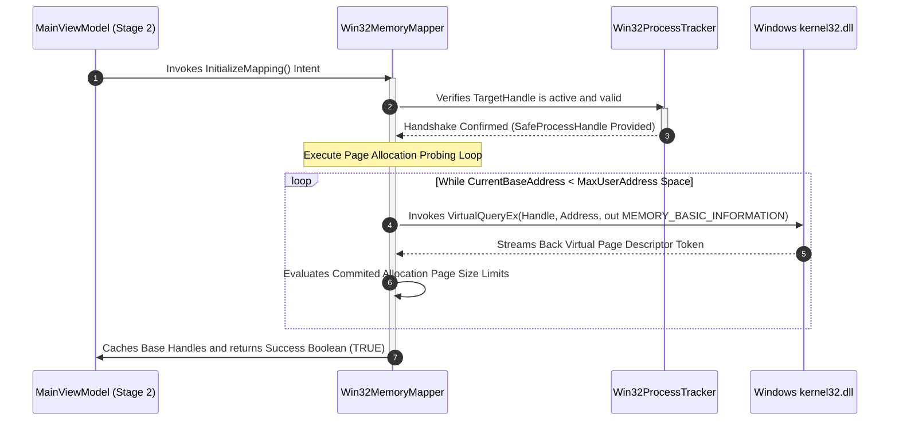

# Unmanaged Virtual Memory Mapping Subsystem

This document profiles the low-level Win32 page-probing configurations used to locate and isolate hypervisor address pools.

---

## 🧭 Memory Probing & Safety Guardrails

*   **Handle Encapsulation Rule:** Virtual memory sweeps require an active `SafeProcessHandle` token passed directly from the `IProcessTracker` instance. Direct pointer retention is strictly prohibited.
*   **Structured Probing Loops:** The application must crawl the target process page map utilizing native `VirtualQueryEx` configurations. Speculative memory reads or hardcoded pointer offsets are banned.
*   **Iterative Protection Filters:** The scanner will analyze memory pages, filtering allocations down to explicit system requirements (`MEM_COMMIT` state combined with `PAGE_READWRITE` accessibility matrix keys).

---

## 📊 Allocation Sweeping Sequence Track

