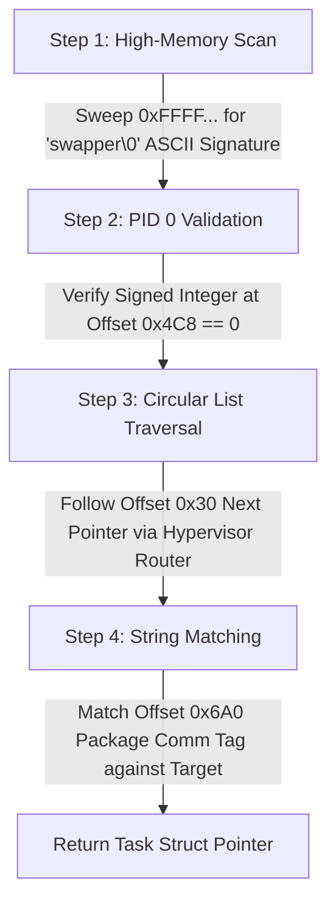

# Service Specification: Process Chain Enumerator

This module defines the requirements for navigating the guest operating system's internal scheduler structures out-of-process to find the target game's memory context.

---

!!! abstract "Functional Objectives"
    *   Locate the unshifting system kernel anchor head node (`init_task` / PID 0).
    *   Traverse the kernel's doubly-linked process array lists cleanly from the host layer.
    *   Isolate the exact task node matching the target game application.

---

## 🧱 Discovery Pipeline Requirements

---

## ⚠️ Architectural Invariants & Alignment Constraints

!!! failure "64-Bit ARM Linux Geometry Bounds"
    The internal structure layouts and structural offsets are explicitly bound to the guest Android 15 kernel architecture. Modifying or overriding these metrics without corresponding documentation updates is strictly prohibited:

    *   **`task_list` Offset:** `0x30` <!-- (1) -->
    *   **`mm_map` Pointer Offset:** `0x480` <!-- (2) -->
    *   **`process_id` Offset:** `0x4C8` <!-- (3) -->
    *   **`process_comm` Offset:** `0x6A0` <!-- (4) -->

1. 🔗 Links circular doubly-linked active execution structures.
2. 🗺️ Memory manager reference hook used to extract translation registers.
3. 🆔 Target validation identifier token.
4. 🏷️ 16-character alphanumeric string descriptor tracking the task name.
